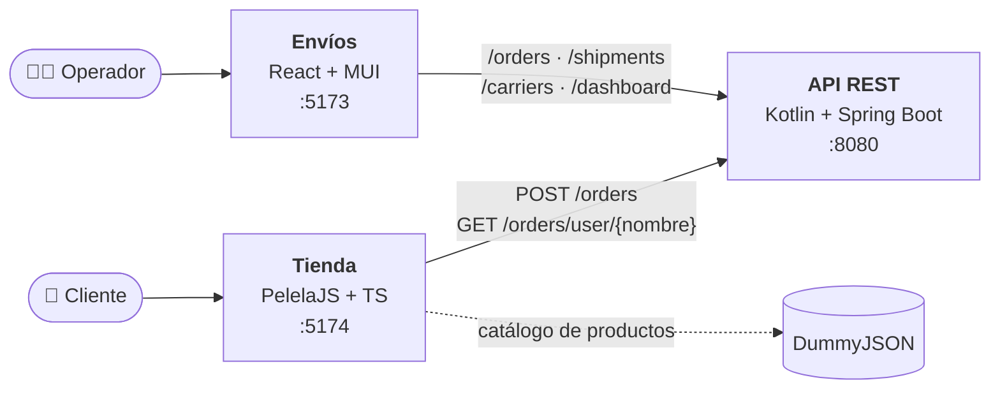

# MercadoLite + MercadoLite Envíos 🛒📦

[](https://github.com/camitermine/mercadolite-envios/actions/workflows/ci.yml)


Un sistema de comercio electrónico con dos aplicaciones web que comparten una **API REST en Kotlin + Spring Boot**:

- **MercadoLite** (la tienda): el cliente busca productos, los compra y sigue sus pedidos. Hecha con **PelelaJS**, un framework MVVM en TypeScript.
- **MercadoLite Envíos** (el panel del operador): una app en **React 19 + Material UI** donde el operador toma los pedidos pendientes, les asigna un transportista, sigue los envíos y administra los transportistas.

Las dos apps no se conocen entre sí: solo hablan con el backend por HTTP/JSON. Lo que une todo es el **número de seguimiento** (`AR-1000xx`), que genera la API.

---

## Cómo funciona



1. El cliente entra a la **tienda**, elige un producto y confirma el pedido. La tienda lo da de alta en la API (`POST /orders`). La API responde `201 Created` y el header `Location` con el número de seguimiento.
2. El pedido aparece en **Pendientes** del panel de envíos. Es una *orden sin envío* y el cliente todavía puede cancelarla.
3. El operador abre **Nuevo envío**, elige un transportista activo y una fecha estimada, y guarda. Ahí nace el **envío**.
4. El estado del envío se calcula, no se guarda: **En camino**, **Demorado** (pasó la fecha estimada) o **Entregado**.
5. El cliente ve ese estado en **Mis pedidos**, en la tienda.

## Funcionalidades

### Tienda (MercadoLite)

| Pantalla | Qué hace |
|---|---|
| Login | Identificación por nombre. La sesión se guarda en `sessionStorage`. |
| Catálogo | Productos de [DummyJSON](https://dummyjson.com/docs/products) con búsqueda, filtros y paginación. |
| Detalle de producto | Galería, calificación con estrellas y reseñas. |
| Hacer pedido | Formulario de entrega con validaciones. Crea la orden en la API. |
| Mis pedidos | Pedidos del usuario con su estado y fecha. Los pendientes se pueden cancelar. |

### Panel de envíos (MercadoLite Envíos)

| Pantalla | Qué hace |
|---|---|
| Dashboard | Indicadores: pedidos por preparar, en camino, entregados hoy y demorados. Muestra también los envíos demorados y las próximas entregas. |
| Pendientes | Órdenes que todavía no tienen envío. |
| Nuevo envío | Asigna transportista y fecha estimada a una orden. Valida en el front y en el back. |
| Envíos | Listado con búsqueda, filtro por estado y paginación. Se puede ver, editar y marcar un envío como entregado. |
| Transportistas | ABM. Solo los activos se pueden asignar, y no se puede borrar uno que tenga envíos. |

## Tecnologías

| Parte | Stack |
|---|---|
| **Backend** (`backend/`) | Kotlin 2.3, Spring Boot 4 (Web MVC + Bean Validation), Jackson, Gradle, JDK 21. Tests con JUnit 5 + MockMvc y cobertura con JaCoCo. |
| **Envíos** (`envios/`) | React 19, TypeScript, Material UI, React Router, Vite. Tests con Vitest + Testing Library. Lint con oxlint. |
| **Tienda** (`tienda/`) | [PelelaJS](https://algo3.uqbar-project.org/herramientas/pelelajs) (vistas `.pelela` + view models en TS), TypeScript, Vite. Tests con Vitest. Lint con Biome. |
| **CI** | GitHub Actions: tests, lint y build de las tres apps en cada push y en cada PR. |

### Decisiones de diseño

- **Backend en capas:** `controller` (con DTOs de `request`/`response`) → `service` → `domain` / `repository`. Los datos viven **en memoria**: la base de datos quedaba fuera del alcance del TP.
- **Errores uniformes:** `BusinessException` (400), `NotFoundException` (404) y `ConflictException` (409). Un `RestExceptionHandler` los traduce siempre al mismo formato `{ code, data, message }`. Los errores por campo van en `data` y el panel de envíos los muestra junto a cada input.
- **REST:** `GET` devuelve 200 con datos. `POST` devuelve 201 con el header `Location` y un mensaje corto, sin el objeto creado. `PUT`/`PATCH`/`DELETE` devuelven 204 sin cuerpo.
- **Estado calculado:** que una orden esté *pendiente* (no tiene envío) o que un envío esté *demorado* se deriva de los datos. No hay un campo que se pueda desincronizar.
- **Front en capas:** en React, las páginas con estado van en `pages/`, los componentes de presentación en `components/`, las validaciones puras en `domain/` y el HTTP en `services/`.

## Cómo correrlo

### Requisitos

- [JDK 21](https://adoptium.net)
- [Node.js 22 o superior](https://nodejs.org)
- [pnpm](https://pnpm.io/installation): `npm install -g pnpm` (o `corepack enable`)

### Opción rápida (Windows)

```bat
git clone https://github.com/camitermine/mercadolite-envios.git
cd mercadolite-envios
start.bat
```

`start.bat` hace todo esto:

1. Revisa que estén Java, Node y pnpm, y que los puertos 8080, 5173 y 5174 estén libres.
2. La primera vez, instala las dependencias de las dos apps de front.
3. Abre tres ventanas: la API (con datos de prueba), Envíos y Tienda.
4. Espera a que responda la API y abre las dos apps en el navegador.

Para cerrar todo: `stop.bat`. En macOS o Linux: `./start.sh` (se cierra con Ctrl+C).

> La primera vez tarda unos minutos, porque Gradle se descarga a sí mismo y baja las dependencias del backend.
> Todas las rutas son relativas a la carpeta del repo: se puede clonar en cualquier lugar.

### Opción manual

En tres terminales distintas:

```bash
# 1. API (http://localhost:8080). El perfil "demo" carga datos de prueba
cd backend
./gradlew bootRun --args='--spring.profiles.active=demo'   # Windows: gradlew.bat bootRun --args="--spring.profiles.active=demo"

# 2. Panel de envíos (http://localhost:5173)
cd envios
pnpm install
pnpm dev

# 3. Tienda (http://localhost:5174)
cd tienda
pnpm install
pnpm dev
```

Los puertos de las apps son fijos porque la API solo acepta pedidos por CORS desde `localhost:5173` y `localhost:5174`.

### Datos de prueba

Con el perfil `demo`, la API arranca con 5 transportistas (uno inactivo), 11 órdenes y 5 envíos, con estados variados para probar todas las pantallas. Sin el perfil, arranca solo con los transportistas. Los datos están en memoria, así que se reinician con cada arranque.

Para ver el recorrido completo desde la tienda, entrá con alguno de estos nombres. Mis pedidos se filtra por usuario, así que los acentos importan:

| Nombre en la tienda | Pedido | Estado |
|---|---|---|
| `Rocío Benítez` | Auriculares inalámbricos | Pendiente (se puede cancelar) |
| `Lucía Fernández` | Notebook Lenovo | En camino |
| `Martín González` | Celular Samsung | Demorado |
| `Diego Ramírez` | Monitor | Entregado |

También podés entrar con cualquier otro nombre, hacer un pedido y seguirlo en el panel de envíos: aparece en Pendientes, le creás el envío y al volver a Mis pedidos ya figura En camino.

## Tests

```bash
cd backend && ./gradlew test     # 94 tests · reporte de cobertura en build/reports/jacoco/test/html
cd envios  && pnpm test          # 109 tests
cd tienda  && pnpm test          # 151 tests
```

En total son **354 tests**. Hay tests de dominio, de servicios, de controllers con MockMvc, de componentes React con Testing Library y de view models de PelelaJS. La CI los corre en cada push junto con el lint y el build.

## Estructura del repo

```
mercadolite-envios/
├── backend/        API REST (Kotlin + Spring Boot)
│   └── src/main/kotlin/.../{controller,service,domain,repository,error,config}
├── envios/         Panel del operador (React + MUI)
│   └── src/{pages,components,domain,services,hooks,routes}
├── tienda/         Tienda del cliente (PelelaJS)
│   ├── src/{pages,components,dominio,services,utils}
│   └── Maquetado/  Entrega 1: maquetado estático HTML/CSS
├── start.bat · stop.bat · start.sh
└── .github/workflows/ci.yml
```

Cada carpeta tiene su propio README con más detalle: endpoints de la API, decisiones de cada app y deuda técnica conocida.

## Las tres entregas

1. **Maquetado** (HTML + CSS): las cinco vistas de la tienda en versión mobile (375px) y web (1440px), con la paleta de colores en variables. Está en [`tienda/Maquetado/`](./tienda/Maquetado).
2. **MercadoLite con PelelaJS:** la tienda funcionando, consumiendo la API de productos de DummyJSON, con view models testeados.
3. **MercadoLite Envíos:** la API REST en Kotlin, el panel en React y la integración con la tienda: cada pedido confirmado se da de alta en la API, y la tienda muestra el estado real del envío.

PelelaJS es un framework de la cátedra ([Uqbar](https://algo3.uqbar-project.org/)).
